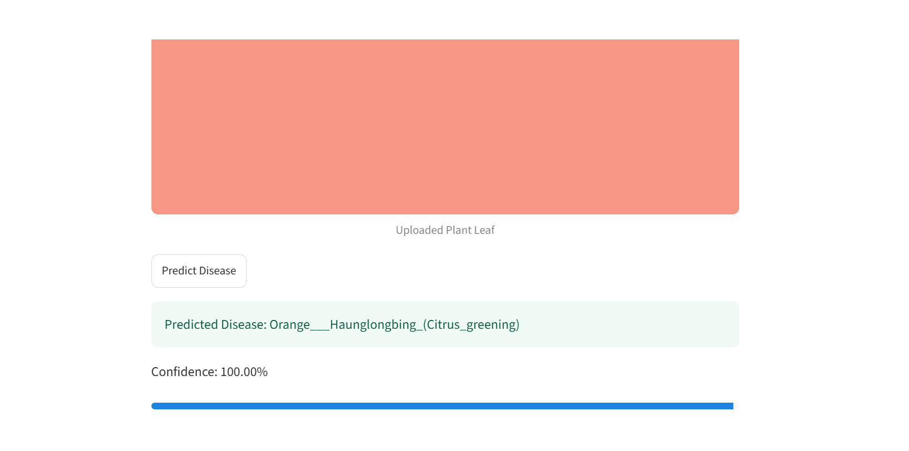

# 🌿 Plant Disease Detection Using CNN

## About the Project

Plant diseases can affect the quality and growth of crops if they are not identified at the right time. To explore how deep learning can help with this problem, I developed a Plant Disease Detection system using a Convolutional Neural Network (CNN).

This project takes a plant leaf image as input and predicts whether it belongs to a particular healthy or diseased category. I also built a simple web application using Streamlit, where users can upload an image and view the prediction along with its confidence score.

## What I Worked On

- Prepared and processed plant leaf images for model training.
- Built and trained a CNN model using TensorFlow and Keras.
- Evaluated the model using test data.
- Achieved **92.38% test accuracy**.
- Saved the trained model for future predictions.
- Developed a Streamlit application to make the model easy to use.

## Technologies Used

- Python
- TensorFlow and Keras
- CNN (Convolutional Neural Network)
- NumPy
- Streamlit
- PIL (Pillow)
- Google Colab

## Model Information

| Details | Description |
|---|---|
| Model | CNN |
| Input Image Size | 128 × 128 pixels |
| Number of Classes | 38 |
| Test Accuracy | 92.38% |
| Framework | TensorFlow / Keras |

## How the Application Works

1. Open the Plant Disease Detection web application.
2. Upload an image of a plant leaf.
3. Click on the **Predict Disease** button.
4. The trained CNN model processes the image.
5. The application displays the predicted disease category and confidence score.

## Project Structure

```text
Plant-Disease-Detection/
│
├── app.py
├── plant_disease_model.keras
├── class_names.json
├── requirements.txt
└── README.md
```

## Run the Project on Your System

**Step 1: Clone the repository**

```bash
git clone https://github.com/vaishnavidoulaghar-web/Plant-Disease-Detection.git
```

**Step 2: Open the project folder**

```bash
cd Plant-Disease-Detection
```

**Step 3: Install the required libraries**

```bash
pip install -r requirements.txt
```

**Step 4: Run the application**

```bash
streamlit run app.py
```

The application will open in your browser.

## What I Learned

While working on this project, I got practical experience with CNN model development, image preprocessing, model training, evaluation and integrating a trained deep learning model with a Streamlit application.

It also helped me understand how machine learning models can be used to solve practical problems in agriculture.

## Application Output

The application allows users to upload a plant leaf image and view the predicted disease along with its confidence score.

### Prediction Result



**Example Prediction:** Orange – Citrus Greening

## Future Improvements

- Add more plant disease categories.
- Include information about detected diseases.
- Provide possible treatment and prevention suggestions.
- Improve the application interface.
- Deploy the application for wider access.

## Developed By

**Vaishnavi Doulaghar**

B.Tech – Electronics and Communication Engineering

[GitHub Repository](https://github.com/vaishnavidoulaghar-web/Plant-Disease-Detection)

---

*This project was developed as part of my learning journey in Python, Deep Learning and AI/ML.*
